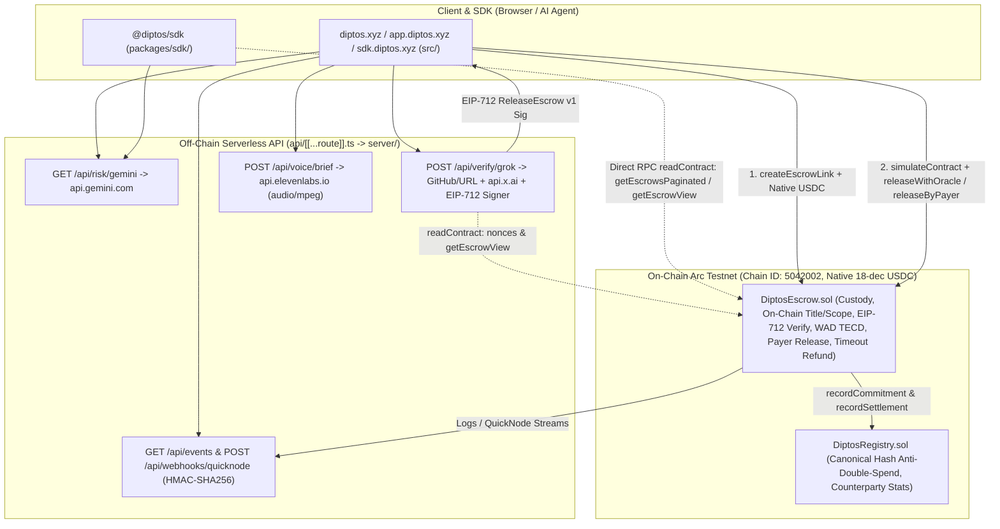

# Diptos — Self-Pricing USDC Settlement & Proof-of-Work Verification Protocol on Arc

**Diptos** is a **Self-Pricing USDC Settlement & Proof-of-Work Verification Protocol on Arc (`Chain ID: 5042002`)** with an open-source TypeScript SDK (`@diptos/sdk`). It turns non-custodial native USDC smart-contract custody into shareable settlement links (`https://app.diptos.xyz/pay/:id`) with on-chain `title` & `acceptanceScope` storage, live prediction-market risk calibration, EIP-712 Grok deliverable auditing, and deterministic on-chain **Time-Entropic Collateral Decay (`TECD`)**.

### Active Working Examples
- **Freelancer & Agency Settlement Links:** A payer originates an escrow on `https://app.diptos.xyz` with on-chain title, acceptance criteria, native 18-decimal Arc USDC principal, and SLA deadline. Once the deliverable PR or URL passes Grok AI inspection (or payer direct approval via `releaseByPayer`), `DiptosEscrow.sol` settles `99.5%` atomically with a flat `0.50%` fee—or applies mathematical TECD buyer rebates if delivery is late.
- **Autonomous AI Agent Task Guardrails:** An AI agent uses `@diptos/sdk` (`prepareAgentEscrowCalldata`) to query live Gemini Prediction Markets volatility and on-chain `DiptosRegistry` counterparty reliability stats before locking native USDC into `DiptosEscrow.sol`.

*Potential* future applications of the same canonical commitment and latency-decay primitives include commercial milestone billing and trade-receivable settlement; those workflows are exploratory and not implemented in this repository.

---

## User & Agent Flow

1. **Originate & Lock Native USDC On-Chain:** On `https://app.diptos.xyz`, the payer connects an EVM wallet on **Arc Testnet (`Chain ID: 5042002`)** and executes `DiptosEscrow.createEscrowLink` with native 18-decimal Arc USDC (`msg.value`), storing `title`, `acceptanceScope`, `deadline`, `lambdaBps`, and `isAgentMode` permanently on-chain. `DiptosRegistry.recordCommitment` records the canonical `keccak256` commitment hash to prevent duplicate origination.
2. **Optional Spoken Risk Brief:** Either party requests an executive audio summary via `POST /api/voice/brief`, streaming live `audio/mpeg` from ElevenLabs (`EXAVITQu4vr4xnSDxMaL` / `eleven_flash_v2_5`) combining on-chain terms and current Gemini macro odds.
3. **Off-Chain Deliverable Audit & EIP-712 Attestation:** The payee submits a GitHub PR URL, repository URL, or live deployment URL to `POST /api/verify/grok`. The backend fetches live GitHub REST API diffs/commits or HTTP metadata, evaluates compliance via xAI Grok, hashes the canonical evidence into `bytes32 deliverableHash`, reads `DiptosEscrow.nonces(escrowId)` from Arc Testnet, and signs an EIP-712 `ReleaseEscrow(bytes32 escrowId,bytes32 deliverableHash,uint256 nonce)` payload (domain `name: "DiptosEscrow"`, `version: "1"`, `chainId: 5042002`).
4. **Atomic On-Chain DvP & TECD Settlement (or Payer Release / Timeout Refund):** Calling `DiptosEscrow.releaseWithOracle` (after pre-flight `simulateContract` check) verifies the EIP-712 signature on-chain and settles `99.5%` to the payee if on-time, or computes exponential WAD decay $V(t) = V_0 \cdot e^{-\lambda (\Delta t / T)^{1.5}}$ to rebate the buyer automatically if late. Payers may also settle directly via `releaseByPayer(escrowId)` or reclaim `100%` permissionlessly via `claimTimeoutRefund(escrowId)` past `deadline + gracePeriod`.

---

## What You Can Verify Yourself

| Claim | Enforced By | Exact Code / Test Reference |
| :--- | :--- | :--- |
| Zero-dust TECD conservation (`payee + rebate + fee == amount`) & monotonic decay | On-chain WAD fixed-point math in `DiptosEscrow.sol` | `contracts/src/DiptosEscrow.sol` (`calculateTECD`) & `contracts/test/DiptosEscrow.t.sol` (`testFuzz_TECDConservationZeroDust`, `testFuzz_TECDDecayMonotonicity` — 256 runs each) |
| Exact EIP-712 `ReleaseEscrow` v1 signature & replay protection | On-chain `DOMAIN_SEPARATOR`, per-escrow `nonces(escrowId)`, EIP-2 `s` check, custom errors | `contracts/src/DiptosEscrow.sol` (`releaseWithOracle`) & `contracts/test/DiptosEscrow.t.sol` (`test_VerifyAndReleaseWithEIP712Oracle`, `test_RevertOnSignatureReplay`, `test_RevertOnWrongOracleSigner`) |
| On-chain `title` & `acceptanceScope` storage + pagination | On-chain `Escrow` struct & `getEscrowsPaginated` | `contracts/src/DiptosEscrow.sol` (`createEscrowLink`, `getEscrowView`, `getEscrowsPaginated`) & `contracts/test/DiptosEscrow.t.sol` (`test_OnChainEnumerationAndPagination`) |
| Anti-double-spend canonical commitment ledger & counterparty telemetry | On-chain `escrowIds` + `canonicalHashes` in `DiptosRegistry.sol` | `contracts/src/DiptosRegistry.sol` (`recordCommitment`, `getCounterpartyStats`) & `contracts/test/DiptosEscrow.t.sol` (`test_RevertOnDoubleSpendEscrowId`, `test_CounterpartyReputationTelemetryOnRegistry`) |
| Permissionless payer recovery & direct payer release | On-chain `claimTimeoutRefund` & `releaseByPayer` | `contracts/src/DiptosEscrow.sol` & `contracts/test/DiptosEscrow.t.sol` (`test_PermissionlessTimeoutRefund`, `test_ReleaseByPayerDirectApproval`) |
| Live Gemini Prediction Markets $\lambda$ calibration | Off-chain Hono route querying Gemini public REST API | `server/src/routes/riskGemini.ts` (`GET /api/risk/gemini`) |
| Deep GitHub/URL evidence fetch + Grok audit + EIP-712 signing | Off-chain Hono route + `viem` `signTypedData` reading on-chain `nonces()` | `server/src/routes/verifyGrok.ts` & `server/src/lib/oracleSigner.ts` |
| QuickNode HMAC-SHA256 webhook verification + block-ordered logs | Off-chain `crypto.timingSafeEqual` + `viem` `getLogs` ordered by `blockNumber` desc | `server/src/routes/quicknode.ts` (`POST /api/webhooks/quicknode`, `GET /api/events`) |
| ElevenLabs executive audio brief streaming | Off-chain Hono route streaming `audio/mpeg` | `server/src/routes/voiceBrief.ts` (`POST /api/voice/brief`) |

---

## Demonstrated vs. Intended Status

| Component | Tier | Code & Test Evidence | Residual Trust / Remaining Work |
| :--- | :--- | :--- | :--- |
| **Smart Contracts (`DiptosEscrow` + `DiptosRegistry`)** | **Demonstrated** | Live on Arc Testnet (`5042002`, Block `#73188305`): `DiptosEscrow` (`0x601bD8caDf9ba2274E645412C1Fca2dF13a318F5`), `DiptosRegistry` (`0xC831EBFA825d88853625C52d1BD55c456111B004`); `17/17` Foundry unit & fuzz tests passing (`forge test -vvv`). | Unaudited testnet deployment; not audited for mainnet custody. |
| **Web Terminal & Checkout (`diptos.xyz`, `app.diptos.xyz`, `sdk.diptos.xyz`)** | **Demonstrated** | `pnpm build:all` passes (`0` TS/Vite errors); wallet initializes disconnected (`address: null`), connects via `window.ethereum`, runs pre-flight `simulateContract`, and reads 100% live on-chain escrows. | Requires an injected EVM wallet (MetaMask/Rabby/Coinbase) to sign on-chain transactions. |
| **Stateless Serverless API (`server/` + `api/[[...route]].ts`)** | **Demonstrated** | Deployed on Vercel Functions via `@hono/node-server/vercel`; `GET /api/oracle/status` confirms `matches: true`; `POST /api/voice/brief` streams live `audio/mpeg` (`HTTP 200`). | Off-chain oracle execution relies on configured server environment variables (`GROK_ORACLE_PRIVATE_KEY`, `ELEVENLABS_API_KEY`). |
| **`@diptos/sdk` (`packages/sdk/`)** | **Demonstrated** | Published live on npm (`@diptos/sdk@1.0.0`); dual ESM (`dist/index.js`), CJS (`dist/index.cjs`), and `.d.ts` built with `tsup` and `0` `workspace:*` leaks. | Future minor release will bundle the v2 on-chain `title`/`acceptanceScope` ABI updates already live in this monorepo. |
| **Multi-Oracle Quorum & Mainnet Audit** | **Intended** | Roadmap item for post-hackathon production hardening. | Planned threshold/quorum oracle verification and external smart contract security audit. |
| **Commercial Milestone Billing & Trade Receivables** | **Potential** | Exploratory domain application of the same canonical hash + TECD primitives. | Not implemented in this repository. |

---

## Architecture



---

## Local Development & Verification

```bash
pnpm install
cp .env.example .env
pnpm dev
```

To run the full smart-contract and workspace verification suite:

```bash
cd contracts && forge test -vvv
pnpm build:all
pnpm --filter @diptos/sdk pack --dry-run
```

---

## Durable Links

- **GitHub Repository:** https://github.com/Jayram2204/Diptos-Arc
- **Live Gateway (`diptos.xyz`):** https://diptos.xyz
- **Live Escrow Terminal (`app.diptos.xyz`):** https://app.diptos.xyz
- **Live SDK Portal (`sdk.diptos.xyz`):** https://sdk.diptos.xyz
- **Published npm Package (`@diptos/sdk@1.0.0`):** https://www.npmjs.com/package/@diptos/sdk
- **Verification & Evidence Log:** [docs/EVIDENCE.md](docs/EVIDENCE.md)
- **TypeScript SDK Documentation:** [packages/sdk/README.md](packages/sdk/README.md)
- **Arc Testnet Explorer:** https://testnet.arcscan.app
- **DiptosEscrow Contract (Arc Testnet):** https://testnet.arcscan.app/address/0x601bD8caDf9ba2274E645412C1Fca2dF13a318F5
- **DiptosRegistry Contract (Arc Testnet):** https://testnet.arcscan.app/address/0xC831EBFA825d88853625C52d1BD55c456111B004
- **ArcUSDC Precompile:** https://testnet.arcscan.app/address/0x3600000000000000000000000000000000000000

---

## Known Limitations & Trust Assumptions

1. **Off-Chain Auditing vs. On-Chain Enforcement:** Grok deliverable auditing (`server/src/routes/verifyGrok.ts`) and Gemini prediction-market risk fetching (`server/src/routes/riskGemini.ts`) execute off-chain on the application server. Fund custody, on-chain `title`/`acceptanceScope` storage, EIP-712 `ReleaseEscrow` signature verification, WAD fixed-point TECD math, anti-double-spend checks, payer direct release (`releaseByPayer`), and permissionless timeout refunds (`claimTimeoutRefund`) are enforced on-chain by `DiptosEscrow.sol` and `DiptosRegistry.sol`.
2. **Oracle Key Authorization Scope:** A valid EIP-712 signature proves authorization by the configured `oracleSigner` (`0x344d7adf93542C6c27a11bb53A2d7C9d909D9f34`), not cryptographic proof of off-chain deliverable truth. If the oracle or payee stalls past `deadline + gracePeriod`, payers retain permissionless recovery of `100%` of locked funds via `claimTimeoutRefund`.
3. **Live Arc Testnet Deployment:** `DiptosEscrow` (`0x601bD8caDf9ba2274E645412C1Fca2dF13a318F5`) and `DiptosRegistry` (`0xC831EBFA825d88853625C52d1BD55c456111B004`) are deployed on Arc Testnet (`Chain ID: 5042002`) with verified live bytecode, 2 initial funded escrows, and a `2.0 USDC` on-chain faucet reserve.
4. **Serverless Webhook Ephemerality:** QuickNode webhook pushes stored in the in-memory `webhookBuffer` reset on Vercel serverless cold starts; `GET /api/events` compensates by querying authoritative `viem` `getLogs` directly from Arc Testnet ordered by `blockNumber` descending.
5. **Unaudited Testnet Software:** Smart contracts have not undergone an independent third-party security audit and are intended for Arc Testnet demonstration only.
