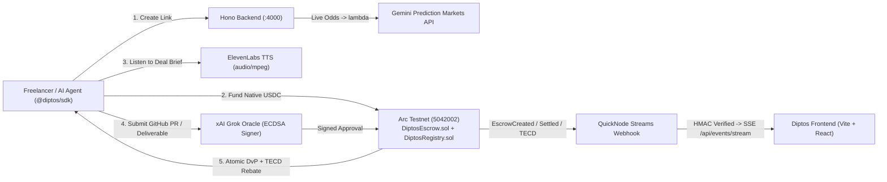

# Diptos (`diptos.xyz`) — Programmable Escrow Links on Arc

> **UBC 2026 Hackathon** · Deployed exclusively on **Arc Testnet (`Chain ID: 5042002`)** with native **USDC** gas & settlement.

Diptos turns programmable crypto escrow into a dead-simple consumer link (`diptos.xyz/pay/:id`) for freelancers, agencies, and autonomous AI agents—combining **0.5% flat settlement fees**, **zero chargebacks**, **Grok AI deliverable verification**, and **Time-Entropic Collateral Decay (`TECD`)** SLA protection.

---

## Architecture



---

## Hackathon Track & Sponsor Bounty Mapping

| Category | Target | Implementation in Diptos |
| :--- | :--- | :--- |
| **Main Track** | **Consumer Applications** | 1-click programmable escrow links (`diptos.xyz/pay/:id`) for human freelancers and AI agents via `@diptos/sdk` (`packages/sdk/`)—zero chargebacks, 0.5% flat fee, invisible crypto UX. |
| **Chain Award** | **Best Use of Arc** | Native USDC gas & atomic DvP escrow (`contracts/src/DiptosEscrow.sol`), anti-double-spend `DiptosRegistry.sol`, and on-chain fixed-point WAD **TECD** exponential decay $P_{\text{payee}} = V_0 \cdot e^{-\lambda \cdot (\Delta t / T)^{1.5}}$ on **Arc Testnet (`5042002`)**. |
| **Sponsor Bounty 1** | **Gemini Prediction Markets** | `GET /api/risk/gemini` (`server/src/routes/riskGemini.ts`) pulls live active contracts from `https://api.gemini.com/v1/prediction-markets/events?status=active&limit=6` to compute a real macro volatility index that dynamically calibrates TECD $\lambda$. |
| **Sponsor Bounty 2** | **QuickNode Streams** | `POST /api/webhooks/quicknode` verifies `x-qn-signature` HMAC-SHA256 webhooks from Arc Testnet and fans out live `EscrowCreated`, `EscrowSettled`, and `TECDPenaltyApplied` events over SSE (`GET /api/events/stream`). |
| **Sponsor Bounty 3** | **Grok Bot (xAI)** | `POST /api/verify/grok` (`server/src/routes/verifyGrok.ts`) fetches GitHub PR/repo evidence, audits deliverable compliance via xAI Grok (`grok-3-mini`), and returns a real `viem` EIP-191 ECDSA signature verified by `DiptosEscrow.releaseWithOracle()`. |
| **Sponsor Bounty 4** | **ElevenLabs** | `POST /api/voice/brief` (`server/src/routes/voiceBrief.ts`) synthesizes and streams real `audio/mpeg` executive deal & SLA risk briefs combining escrow terms, live Gemini odds, and TECD penalty schedules. |

---

## Arc Testnet (`5042002`) Configuration

- **RPC:** `https://rpc.testnet.arc.io`
- **Explorer:** `https://explorer.testnet.arc.io`
- **Native Gas & Settlement Token:** `USDC`
- **Faucet:** `https://faucet.circle.com`
- **Contracts:**
  - `DiptosEscrow.sol`: configured via `VITE_ESCROW_CONTRACT_ADDRESS` (deploy with `contracts/script/DeployArc.s.sol`)
  - `DiptosRegistry.sol`: configured via `VITE_REGISTRY_CONTRACT_ADDRESS`

```bash
# Run Foundry unit tests (TECD fixed-point math, anti-double-spend, Grok ECDSA release)
cd contracts && forge test -vv

# Deploy to Arc Testnet (Chain ID 5042002)
forge script script/DeployArc.s.sol:DeployArc --rpc-url https://rpc.testnet.arc.io --broadcast
```

---

## 3-Command Local Startup

```bash
pnpm install
cp .env.example .env   # add XAI_API_KEY, ELEVENLABS_API_KEY, GROK_ORACLE_PRIVATE_KEY
pnpm dev
```

- **Frontend (Vite + React):** `http://localhost:8443`
- **Backend API & SSE (Hono):** `http://localhost:4000` (proxied automatically via `/api`)
- **SDK:** `packages/sdk/src/index.ts` (`@diptos/sdk`)
